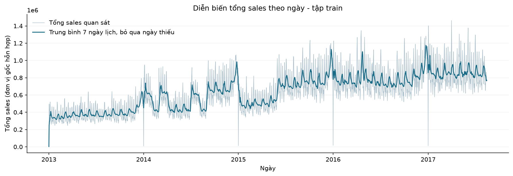
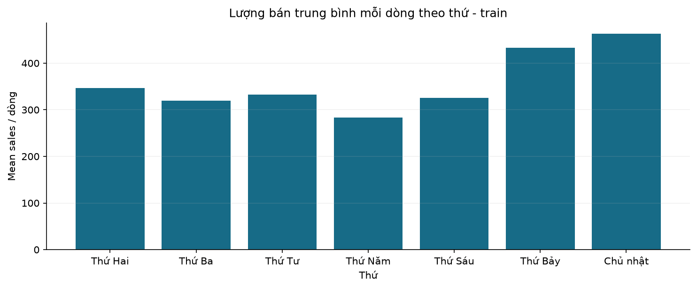
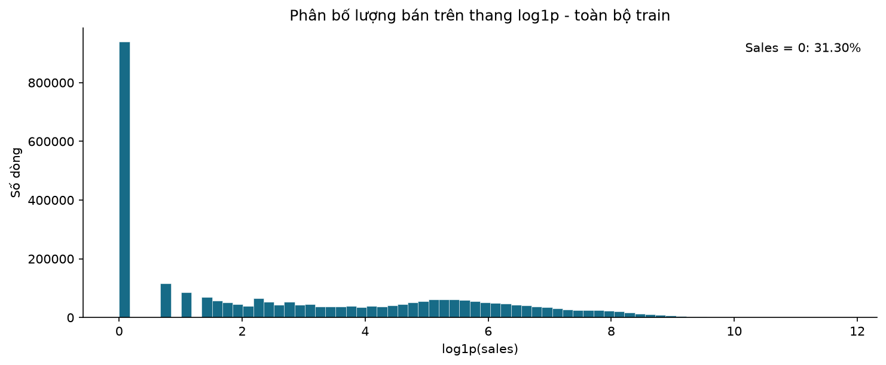
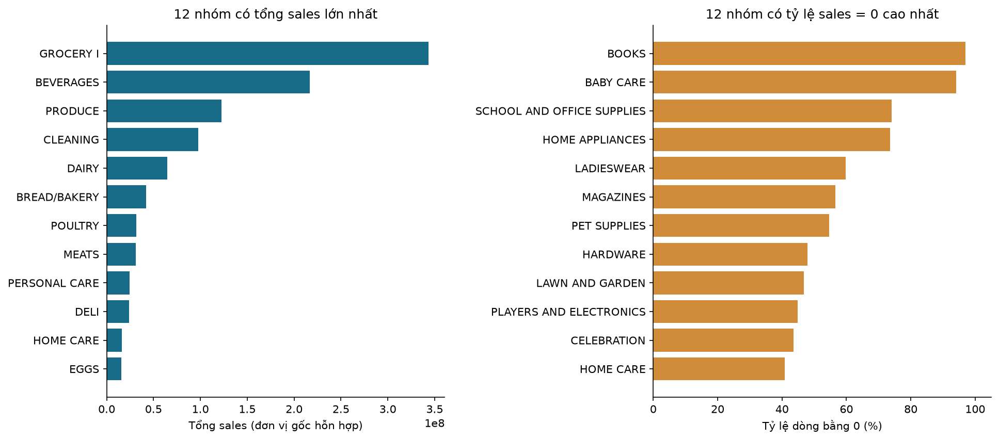
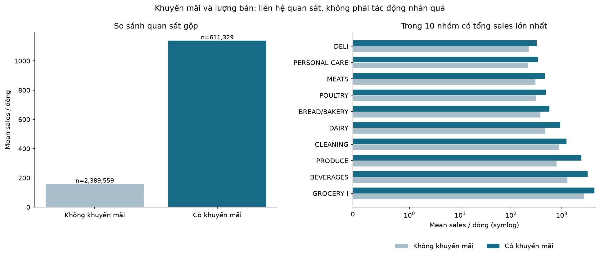
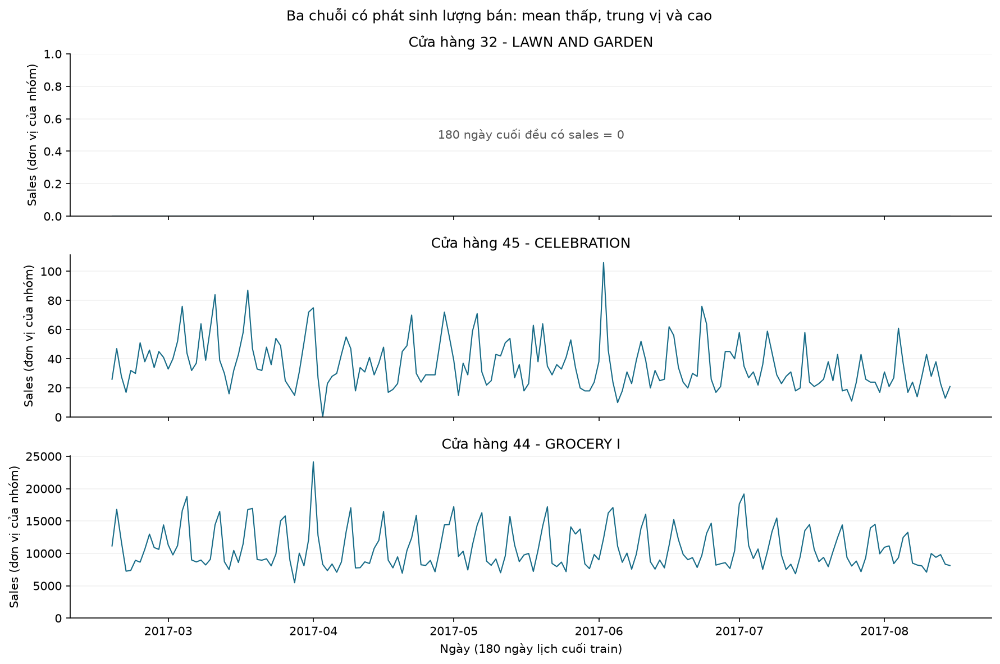

# EDA - Phần việc TV1

Nguồn: 7 CSV tại `data/raw/`. Các thống kê lượng bán chỉ dùng `train.csv`; không có mô hình được huấn luyện trong bước này.

## Phạm vi dữ liệu

- Train: **3,000,888 dòng**, 2013-01-01 đến 2017-08-15.
- Test: **28,512 dòng**, 16 ngày, 2017-08-16 đến 2017-08-31.
- Có **54 cửa hàng, 33 nhóm hàng, 1,782 chuỗi cửa hàng-nhóm hàng**.
- Các ngày không xuất hiện trong train: 2013-12-25, 2014-12-25, 2015-12-25, 2016-12-25. Ngày thiếu không được điền thành sales = 0.

## Các phát hiện

1. **Nhiều số 0:** 939,130 dòng (31.30%) có sales = 0. Nhóm BOOKS có tỷ lệ cao nhất (96.96%). Không thể chỉ từ sales = 0 kết luận hết hàng, đóng cửa hay không có nhu cầu.
2. **Phân bố lệch:** mean 357.78, median 11.00, p95 1,965.00, p99 5,507.00, max 124,717.00. Cần xem thêm thang log để quan sát cả giá trị nhỏ và lớn; EDA không loại các giá trị lớn này.
3. **Khác biệt theo thứ:** Chủ nhật có mean sales/dòng cao nhất (463.09); Thứ Năm thấp nhất (283.54) khi gộp toàn bộ train. Kết quả mô tả không bảo đảm áp dụng giống nhau cho từng cửa hàng/nhóm hàng hoặc tương lai.
4. **Khác biệt quy mô nhóm hàng:** nhóm có tổng sales lớn nhất là GROCERY I. Tổng này cộng đại lượng có thể khác đơn vị giữa các nhóm, nên không diễn giải thành doanh thu hoặc so sánh giá trị kinh tế.
5. **Đơn vị bán có thể lẻ:** có 462,113 dòng sales là số thập phân; giữ kiểu số thực, không làm tròn nhãn thành số nguyên.
6. **Liên hệ với khuyến mãi:** mean sales/dòng khi onpromotion > 0 là 1,137.69 (n=611,329); khi bằng 0 là 158.25 (n=2,389,559). Biểu đồ bổ sung so sánh trong từng family. Đây không phải ước lượng tác động: còn khác biệt thời gian, cửa hàng, nhu cầu và cách chọn khuyến mãi.

## Bảng tóm tắt nhóm hàng

| Nhóm hàng | Mean sales/dòng | Tỷ lệ sales = 0 |
|---|---:|---:|
| GROCERY I | 3,776.97 | 8.06% |
| BEVERAGES | 2,385.79 | 8.06% |
| PRODUCE | 1,349.35 | 28.36% |
| CLEANING | 1,072.42 | 8.06% |
| DAIRY | 709.15 | 8.06% |
| BREAD/BAKERY | 463.34 | 8.06% |
| POULTRY | 350.53 | 8.08% |
| MEATS | 341.85 | 8.06% |
| PERSONAL CARE | 270.43 | 8.07% |
| DELI | 265.14 | 8.06% |
| HOME CARE | 176.20 | 40.91% |
| EGGS | 171.42 | 8.06% |
| FROZEN FOODS | 154.77 | 8.09% |
| PREPARED FOODS | 96.77 | 8.08% |
| LIQUOR,WINE,BEER | 85.19 | 17.87% |
| SEAFOOD | 22.16 | 19.36% |
| GROCERY II | 21.58 | 12.11% |
| HOME AND KITCHEN I | 20.47 | 34.65% |
| HOME AND KITCHEN II | 16.72 | 34.71% |
| CELEBRATION | 8.37 | 43.63% |
| LINGERIE | 7.18 | 16.05% |
| LADIESWEAR | 7.16 | 59.85% |
| PLAYERS AND ELECTRONICS | 6.19 | 44.89% |
| AUTOMOTIVE | 6.10 | 12.78% |
| LAWN AND GARDEN | 6.04 | 46.78% |
| PET SUPPLIES | 3.92 | 54.62% |
| BEAUTY | 3.72 | 26.28% |
| SCHOOL AND OFFICE SUPPLIES | 2.96 | 74.08% |
| MAGAZINES | 2.93 | 56.54% |
| HARDWARE | 1.14 | 47.86% |
| HOME APPLIANCES | 0.46 | 73.52% |
| BABY CARE | 0.11 | 94.13% |
| BOOKS | 0.07 | 96.96% |

## Dữ liệu phụ và quyết định bàn giao

- Ngày lễ: 350 dòng nhưng chỉ 312 ngày khác nhau; 12 dòng là ngày gốc đã chuyển. Tổng hợp theo ngày/cửa hàng và phạm vi trước khi ghép, giữ cờ sự kiện riêng.
- Oil có 43 giá trị thiếu ngay trong CSV; lịch thiếu dòng được báo riêng trong data_quality.md. Bảng nền chưa tự thêm giá dầu hay nội suy.
- Transactions kết thúc 2017-08-15; không có giao dịch thực cho test. Giữ nguyên nguồn, không ghép giao dịch tương lai vào đầu vào dự báo.
- Bảng nền giữ sales và id gốc, chỉ ghép metadata/lịch/lễ. Chưa tạo lag, scaler hay chọn mô hình; các bước dùng nhãn để học phải được các thành viên khác thực hiện theo cách kiểm định nhóm thống nhất.
- Phân tích toàn bộ train ở đây phục vụ mô tả. Các kết luận liên quan lựa chọn đặc trưng không thay thế kiểm định dự báo theo thời gian.

## Biểu đồ

